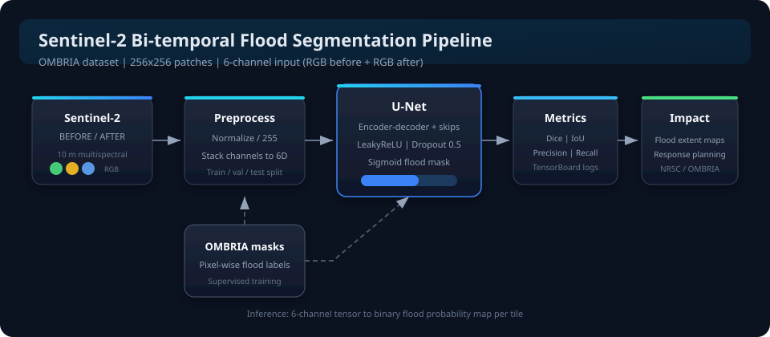
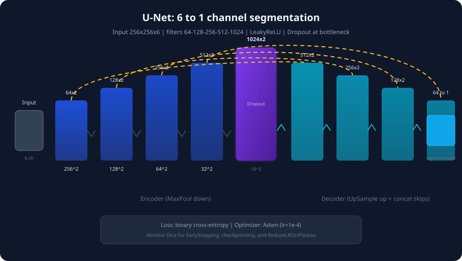
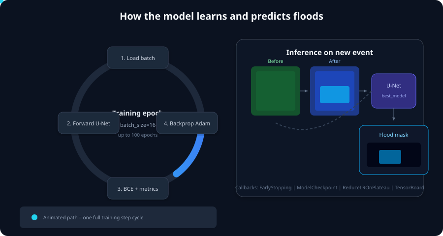

# Flood Detection with Deep Learning

[](https://www.python.org/)
[](https://www.tensorflow.org/)
[](LICENSE)

**Bi-temporal Sentinel-2 segmentation for flood extent mapping** using a custom **U-Net** trained on the **[OMBRIA](https://www.ombria.org/)** change-detection dataset. The notebook loads pre- and post-event RGB tiles, learns pixel-wise flood masks, and evaluates with **Dice**, **IoU**, **precision**, and **recall**—supporting rapid disaster mapping workflows (including NRSC-oriented experiments).

<p align="center">
  
</p>

---

## Highlights

| | |
|---|---|
| **Input** | Paired **before / after** Sentinel-2 RGB patches (`256×256×6`) |
| **Output** | Binary **flood probability map** (`256×256×1`, sigmoid) |
| **Model** | **U-Net** encoder–decoder with skip connections, LeakyReLU, dropout at bottleneck |
| **Training** | Adam `1e-4`, binary cross-entropy, batch size **16**, up to **100** epochs |
| **Monitoring** | TensorBoard, EarlyStopping on **Dice**, best-weight checkpoint, LR plateau |

---

## Architecture

### System pipeline

Satellite pairs and OMBRIA masks flow through preprocessing, the U-Net, metric tracking, and operational flood maps:

<p align="center">
  
</p>

### U-Net topology

Contracting path (max pooling), bottleneck at `1024` filters, expanding path with **concatenated skip features**:

<p align="center">
  
</p>

### Training & inference (animated)

<p align="center">
  
</p>

> SVG animations render in GitHub’s README viewer and most modern browsers.

---

## Repository layout

```
FloodDetection-DeepLearning/
├── ombria_code_nrsc.ipynb   # Full workflow: data → train → evaluate → visualize
├── requirements.txt
├── LICENSE
└── docs/assets/             # Architecture & training SVG diagrams
    ├── system-architecture.svg
    ├── unet-architecture.svg
    └── training-flow-animated.svg
```

---

## Dataset layout

Place (or mount) OMBRIA Sentinel-2 tiles in this structure and point the paths in the notebook:

```
OmbriaS2/
├── train/
│   ├── BEFORE/    # Pre-event RGB GeoTIFF/PNG
│   ├── AFTER/     # Post-event RGB
│   └── MASK/      # Flood / change labels
└── test/
    ├── BEFORE/
    ├── AFTER/
    └── MASK/
```

The reference notebook uses Google Colab paths (`/content/drive/MyDrive/OmbriaS2/...`). Update those strings to your local or cloud storage.

---

## Quick start

### 1. Environment

```bash
python -m venv .venv
# Windows
.venv\Scripts\activate
# Linux / macOS
source .venv/bin/activate

pip install -r requirements.txt
```

### 2. Run the notebook

```bash
jupyter notebook ombria_code_nrsc.ipynb
```

Recommended flow inside the notebook:

1. **Load & normalize** images (`÷ 255`), stack before/after → 6 channels  
2. **Split** train/validation (`train_test_split`, 60/40 on the training pool)  
3. **Build** `unet(input_size=(256, 256, 6))`  
4. **Train** with callbacks (TensorBoard, EarlyStopping, `best_model.keras`)  
5. **Evaluate** on the held-out test set and **visualize** predictions vs. ground truth  

### 3. TensorBoard (optional)

```bash
tensorboard --logdir logs4
```

---

## Model summary (code)

Core building blocks live in `ombria_code_nrsc.ipynb`:

- **Input fusion:** `np.dstack((before, after))` → 6-channel tensor  
- **Head:** `Conv2D(1, 1, activation='sigmoid')` flood mask  
- **Metrics:** `MeanIoU`, custom **Dice**, thresholded precision/recall  
- **Regularization:** `Dropout(0.5)` on deepest encoder features and bottleneck  

---

## Results & metrics

Training logs in the notebook report **loss**, **accuracy**, **mean IoU**, **Dice coefficient**, **precision**, and **recall** on validation and test splits. Use **Dice**-based checkpointing for imbalanced flood pixels.

Example evaluation cell output structure:

```
Test loss: ...
Test accuracy: ...
Test Mean IoU: ...
Test Dice Coefficient: ...
Test Precision: ...
Test Recall: ...
```

Re-run training on your full OMBRIA split for production-grade numbers; the bundled notebook used a **subset** of tiles (`max_images` limits) for faster experimentation.

---

## Hardware notes

- **GPU** strongly recommended (TensorFlow + conv stacks at 256²).  
- Colab / local CUDA both work; ensure TensorFlow sees your GPU (`tf.config.list_physical_devices('GPU')`).  

---

## Acknowledgements

- **[OMBRIA](https://www.ombria.org/)** — open benchmark for optical change detection and flood-related events  
- **Sentinel-2** — Copernicus programme multispectral imagery  
- **U-Net** — Ronneberger et al., biomedical segmentation architecture adapted here for remote sensing  

---

## License

This project is released under the terms in [LICENSE](LICENSE).

---

## Author

Developed for flood / change detection research and operational prototyping (NRSC notebook variant: `ombria_code_nrsc.ipynb`).

**Questions or improvements?** Open an issue or PR on this repository.
